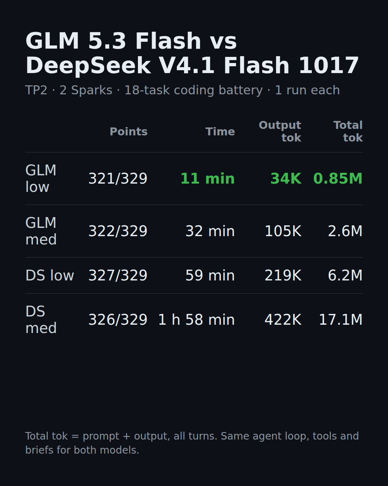

# GLM 5.3 Flash vs DeepSeek V4.1 Flash 1017 on two DGX Sparks (TP2)

We ran two public recipes on the same pair of NVIDIA DGX Sparks (GB10, 128 GB each, one QSFP cable between the
ConnectX-7 ports, tensor parallel 2), and gave both models the same 18-task agentic coding battery. This repository
has our results, how we launched each recipe, and what we changed. It holds no code from the recipes: they are
linked below at the exact commits we ran.

## Results

One run per row. Points = hidden tests passed (329 in total over 18 tasks). Wall = sum of the 18 task times.
Output tokens = completion tokens (thinking + answer + tool calls), all turns. Total tokens = prompt + output, all
turns. Thinking tokens come from the server's `usage.completion_tokens_details.reasoning_tokens`.

| Model | Thinking effort sent (what the template rendered) | Tasks /18 | Points /329 | Wall | Thinking tok | Output tok | Total tok |
|---|---|---:|---:|---:|---:|---:|---:|
| GLM 5.3 Flash | low (`Reasoning Effort: Low`) | 15 | 321 | 668 s (11 min) | 5,225 | 33,603 | 846,532 |
| GLM 5.3 Flash | high (`Reasoning Effort: High`) | 15 | 322 | 1,902 s (32 min) | 35,922 | 104,723 | 2,594,907 |
| DeepSeek V4.1 Flash 1017 | minimal (`Effort: 25`) | 14 | 322 | 1,880 s (31 min) | 51,607 | 112,533 | 2,558,254 |
| DeepSeek V4.1 Flash 1017 | low (`Effort: 50`) | 16 | 327 | 3,555 s (59 min) | 105,728 | 218,885 | 6,184,352 |
| DeepSeek V4.1 Flash 1017 | medium (`Effort: 62`) | 15 | 326 | 7,103 s (1 h 58 min) | 252,541 | 421,875 | 17,130,612 |
| DeepSeek V4.1 Flash 1017 | high (`Effort: 75`) | 16 | 327 | 9,795 s (2 h 43 min) | 389,150 | 607,059 | 21,958,013 |

The card calls the GLM high row "GLM med": GLM 5.3 Flash's chat template knows only `low`, `high` and `max`, and the
GLM recipe sends `medium` as `high`. Thinking-off rows for both models will be added here when they are done.
The same numbers are in [`results/results.tsv`](results/results.tsv).

**Read with care.** One run per row, so a 1-point difference is within run-to-run noise. The two stacks differ in
more than the model: GLM runs 4.0 bpw EXL3 weights with a DFlash2 drafter on TensorFold v0.6.0; DeepSeek runs
2.9 bpw EXL3 weights with its own MTP drafts on a TensorFold fork. Both used their recipe's default sampling and
serving settings.

## The battery (method)

- 18 coding tasks in 5 groups: static-site changes (3), FastAPI app features (3), SQL-to-CSV/JSON data reports (3),
  seeded bug fixes (3), and 6 harder tasks (stream reassembly, a three-defect bug fix, time-zone-aware
  sessionization, a stateful scheduler, a crash-safe data migration, a log-reconcile planner). Each task is a
  redacted copy of a real repository (or a seeded fixture) plus a written brief.
- The agent loop is the same for both models: the same system prompt, the same briefs, and the same 8 tools
  (`list_dir`, `read_file`, `write_file`, `str_replace`, `grep`, `bash`, `run_smoke`, `done`), sent over the
  OpenAI-compatible chat API with tool calls. The model may run a public smoke test for each task.
- Caps per task: 120 turns, 3,600 s wall, `max_tokens` 32,768 per reply. The only per-model request setting is
  `reasoning_effort`; everything else is the server's default.
- After the run, each task's final diff is applied to a fresh copy of the repository and the smoke test runs again
  (all six runs: every diff applied and every smoke passed). Then a hidden test suite grades each task. The hidden
  tests are not published, so that the battery stays useful.

## How we launched GLM 5.3 Flash

Recipe: [MiaAI-Lab/GLM-5.3-Flash-EXL3-2x-DGX-Sparks-TensorFold](https://github.com/MiaAI-Lab/GLM-5.3-Flash-EXL3-2x-DGX-Sparks-TensorFold)
at commit `3fd60dfc836fab0f1ed0fd4f0afaf2a1d62b2aab`. Follow its README; it runs everything from the head node.

1. On the head: clone the recipe at that commit, copy `scripts/local.sh.example` to `scripts/local.sh`, and set
   `WORKER=user@<worker's CX7 address>`. Nothing else in it.
2. `./scripts/prepare.sh` (image on both nodes, weights at the pinned revisions on both nodes, checks), then
   `./start.sh`. It prints `GLM-5.3-Flash-EXL3 is now LIVE! on port 8888`. Model id: `GLM-5.3-Flash-EXL3`.
3. All settings at the recipe's defaults: context 1,048,576, 4 parallel requests, FP8 KV cache, DFlash2 drafter.

What we did differently: our two nodes reach the internet only over Wi-Fi, so we downloaded the files on another
machine and copied them into the Hugging Face cache on both nodes, then checked every file against its Hugging Face
sha256 before `prepare.sh` (which found them and skipped the download). The image is the recipe's prebuilt image,
pulled by digest on a wired machine and loaded on both nodes.

Pins: image `ghcr.io/miaai-lab/glm-5.3-flash-exl3-2x-dgx-sparks-tensorfold@sha256:14b5072e8e9918f1080153f57321415a387bc7d78cf9c9b44a7aeae2d4399ccf`
(TensorFold v0.6.0 plus the recipe's patches); weights
[Mia-AiLab/GLM-5.3-Flash-EXL3-4bpw-TensorFold](https://huggingface.co/Mia-AiLab/GLM-5.3-Flash-EXL3-4bpw-TensorFold)
at revision `078455ffe6472f9a52fbc1139f58b9db2881b25c`; drafter
[incoai/GLM-5.3-Flash-DFlash2](https://huggingface.co/incoai/GLM-5.3-Flash-DFlash2) at revision
`bf582e4eacc1810f76656d1811693ff6c6737d2a`.

## How we launched DeepSeek V4.1 Flash 1017

Recipe: [Elevatormusic/DeepSeek-V4.1-Flash-1017-EXL3-TensorFold-2x-DGX-Spark](https://github.com/Elevatormusic/DeepSeek-V4.1-Flash-1017-EXL3-TensorFold-2x-DGX-Spark)
at commit `3b6d54064241dd7f442ddd2f6079d88e3e3ddb59`. Follow its README (steps 1-7); notes per step:

1. `.env` from `.env.example`: head and worker CX7 addresses, `WORKER_SSH`, the RoCE device and netdev names,
   `GID_INDEX=3` (the RoCE v2 IPv4 entry on all four of our devices), `BIND_HOST=0.0.0.0`. Everything else at the
   defaults: context 1,048,576, `PARALLEL=4`, `MTP_DRAFTS=5`, temperature 1.0, top-p 1.0.
2. Weights: we staged the files the same way as for GLM and built the recipe's model view by hand (EXL3 2.9 bpw
   files in `model/`, Engram shards 47/48 plus `model.safetensors.index.json` and `config.json` of the base repo
   as hard links in `engram/`), then checked all files against the recipe's own `runs/2026-10-17/weights.sha256` on
   both nodes. `scripts/download.sh` does the same from the internet.
3. `scripts/patch_template.py --worker` as written: it downloads the chat template of the MiaAI DeepSeek kit at a
   pinned commit, checks its sha256, applies a one-hunk patch (tools and `response_format` reach the model when
   there is no system message), checks the result's sha256 (`defbdfc2…`), and copies it to the worker.
4. `docker/build.sh` builds the engine image from the TensorFold fork at commit `07aa02585f64`. We ran the same
   Dockerfile on a wired machine and loaded the image on both nodes (same image ID on both).
5. `scripts/host_tuning.sh`: **skipped** (see below).
6. `PREFLIGHT=0 ./start.sh`. First start about 7 minutes. Model id: `DeepSeek-V4.1-Flash-1017`.
7. `./verify.sh`: 5/5 passed.

### Our deviations from the DeepSeek recipe

- **Host tuning skipped.** The recipe's `host_tuning.sh` changes system settings on both nodes (swappiness,
  `min_free_kbytes`, watermark scale, transparent huge pages off, earlyoom, a no-swap cgroup slice). GLM ran on the
  same nodes without these changes, so we left the hosts as they were for both models: `CGROUP_PARENT=` (empty) in
  `.env` and `PREFLIGHT=0`, because the preflight fails on exactly those checks. Both DeepSeek ranks served all
  DeepSeek runs from one start, with no restart.
- **Different RoCE device names per node.** The recipe uses one `RDMA_DEVICES` / `NCCL_IB_HCA` /
  `NCCL_SOCKET_IFNAME` value for both ranks. On our pair the cable sits in CX7 port 0 of the head
  (`rocep1s0f0,roceP2p1s0f0`, netdev `enp1s0f0np0`) and port 1 of the worker (`rocep1s0f1,roceP2p1s0f1`, netdev
  `enp1s0f1np1`). We added three worker values to `.env` (`WORKER_RDMA_DEVICES`, `WORKER_NCCL_IB_HCA`,
  `WORKER_NCCL_SOCKET_IFNAME`) and two lines at the top of `run_args()` in our local copy of `start.sh`: for rank 1
  they replace the three values with the worker ones. With the cable in the same port on both nodes, no change is
  needed.

## Thinking effort: check what the template really renders

The effort word you send is not always the effort the model sees. [`scripts/check_effort.py`](scripts/check_effort.py)
asks a running server to render the prompt for each effort value (`/tokenize` + `/detokenize`) and sends one short
request, then prints the rendered prompt and the reasoning-token count. What we saw:

| Sent | GLM 5.3 Flash renders | DeepSeek V4.1 Flash 1017 renders |
|---|---|---|
| `minimal` | - | `Effort: 25` |
| `low` | `Reasoning Effort: Low` | `Effort: 50` |
| `medium` | `Reasoning Effort: High` (the recipe maps medium to high) | `Effort: 62` |
| `high` | `Reasoning Effort: High` | `Effort: 75` |
| `none` | - | no effort line; prompt ends with `</think>`; 0 reasoning tokens |

## Credits and licences

- **GLM-5.3-Flash** by [Z.ai](https://huggingface.co/zai-org/GLM-5.3-Flash): the model. Licence on its model card.
- **Mia's AI Lab** ([MiaAI-Lab](https://github.com/MiaAI-Lab)): the GLM recipe (Apache-2.0) and its prebuilt image,
  the EXL3 4 bpw checkpoint (Apache-2.0), and the DeepSeek vLLM kit whose chat template the DeepSeek recipe patches
  ([MiaAI-Lab/DeepSeek-v4.1-Flash-EXL3-2x-DGX-Sparks](https://github.com/MiaAI-Lab/DeepSeek-v4.1-Flash-EXL3-2x-DGX-Sparks)
  at `6f7d1590ad49a2b8995188e45d7b9db31e677452`, AGPL-3.0).
- **IncoAI**: the DFlash2 drafter, CC BY-NC-ND 4.0, **non-commercial use only**.
- **DeepSeek**: [DeepSeek-V4.1-Flash-1017](https://huggingface.co/deepseek-ai/DeepSeek-V4.1-Flash-1017) (MIT),
  Engram shards 47/48 at revision `1bae0e1088993b9b82de08f59de5be5a34e42170`.
- **LibertAIDAI**: [the EXL3 2.9 bpw quantization](https://huggingface.co/LibertAIDAI/DeepSeek-V4.1-Flash-1017-EXL3-2.9bpw)
  (MIT) at revision `afc7aa0aab98ee735c0f54e0a122019af1ac08f1`.
- **Elevatormusic**: the DeepSeek recipe (Apache-2.0) and the
  [TensorFold fork](https://github.com/Elevatormusic/TensorFold) at `07aa02585f64`.
- **bertholomus** (Bertholomus AI), with fixes by willjriley and Capicua25x: the DeepSeek V4.1 TP2 engine in
  TensorFold that the DeepSeek recipe builds on.
- **[TensorFold](https://github.com/ashhart/TensorFold)** by Ash Hart and contributors: the engine under both
  recipes (Apache-2.0 from v0.6.0; earlier code MIT).
- **turboderp**: [ExLlamaV3](https://github.com/turboderp-org/exllamav3), the EXL3 format (MIT).
- **NVIDIA**: the NGC PyTorch base image of both engines, under NVIDIA's licence terms.

Each recipe's own `CREDITS.md` and `NOTICE` list more contributors. The model weights, images and templates keep
their own licences and are not in this repository.

Our own files here (README, results, `scripts/check_effort.py`) are MIT, see [LICENSE](LICENSE).
